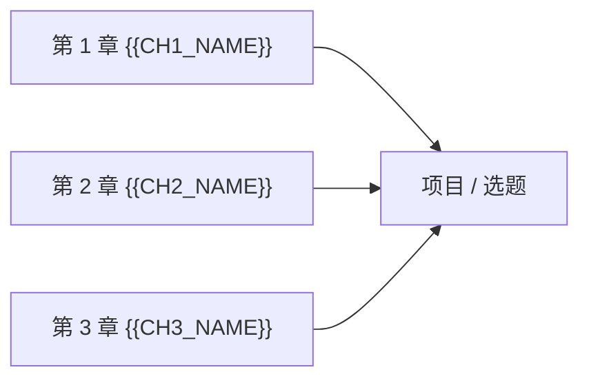

# C{{CHAPTER_NO}} 毕业设计：把整门课用起来

> <b>*Note*</b>
> 这一章是什么
>
> 前面每一章都在给你零件，这一章把它们装成一台能跑的东西。这里有几个动手实践的选题，从"把课内的做一遍并扩展"到"自己查资料做取舍"。
>
> <b>建议</b>：至少完成一个<b>综合型</b>选题。做完之后回头看前几章，你会发现自己读懂了很多第一次没读懂的地方。

---

## 一、全课程知识地图

<!-- 把这门课所有章节的知识点连成一张图，标注每个节点在下面的选题里会被用到。 -->

| 章节 | 核心工具 | 在哪些选题里用到 |
|---|---|---|
| 第 1 章 {{CH1_NAME}} | {{TOOL_1}} | 选题 A、B |
| 第 2 章 {{CH2_NAME}} | {{TOOL_2}} | 选题 A、C |

---

## 二、选题 A（巩固型）{{PROJECT_A_TITLE}}

**目标**：{{PROJECT_A_GOAL}}

**要求**
1. {{PROJECT_A_REQ_1}}
2. {{PROJECT_A_REQ_2}}
3. {{PROJECT_A_REQ_3}}

**需要用到**：{{PROJECT_A_CHAPTERS}}

**完成标准**：{{PROJECT_A_DONE}}

**评分要点**
- {{PROJECT_A_RUBRIC_1}}（{{A_R1}} 分）
- {{PROJECT_A_RUBRIC_2}}（{{A_R2}} 分）
- {{PROJECT_A_RUBRIC_3}}（{{A_R3}} 分）

**示例 / 参考实现**

{{PROJECT_A_SAMPLE}}

---

## 三、选题 B（综合型）{{PROJECT_B_TITLE}}

**目标**：{{PROJECT_B_GOAL}}

**要求**
1. {{PROJECT_B_REQ_1}}
2. {{PROJECT_B_REQ_2}}

**需要用到**：{{PROJECT_B_CHAPTERS}}

**完成标准**：{{PROJECT_B_DONE}}

**评分要点**
- {{PROJECT_B_RUBRIC_1}}（{{B_R1}} 分）
- {{PROJECT_B_RUBRIC_2}}（{{B_R2}} 分）

**示例 / 参考实现**

{{PROJECT_B_SAMPLE}}

<!-- 代码类科目：给出总体完整代码，并在每处标注所属章节知识（写节名，不写编号），例如：
     # 见 C3 Sec_2 自动微分：链式法则
     「需要用到」写成指向对应节的链接：[C3 Sec_2 …](../Cha_3%20…/C3%20Sec_2%20….md)
-->

---

## 四、选题 C（挑战型）{{PROJECT_C_TITLE}}

**目标**：{{PROJECT_C_GOAL}}

**要求**：{{PROJECT_C_REQUIREMENTS}}

**需要用到**：{{PROJECT_C_CHAPTERS}}

**提示与方向**（不给完整答案）：{{PROJECT_C_HINTS}}

**评分要点**：{{PROJECT_C_RUBRIC}}

---

## 五、做完之后

> <b>*Tip*</b>
> 做完之后自检
>
> - [ ] 我知道这个作品里每一部分对应课内哪个知识点
> - [ ] 我能不看笔记把它重新做一遍
> - [ ] 我说得出自己做的取舍和它的代价
> - [ ] 我能指出它还有哪些没解决的局限

> <b>*Tip*</b>
> 编者按
>
> {{CAPSTONE_ADVICE}}（这门课学到这里，接下来可以往哪走：进阶方向、值得读的书或项目、常见的下一步误区。）

---

返回大纲：[00 大纲](../00%20%E5%A4%A7%E7%BA%B2.md)
