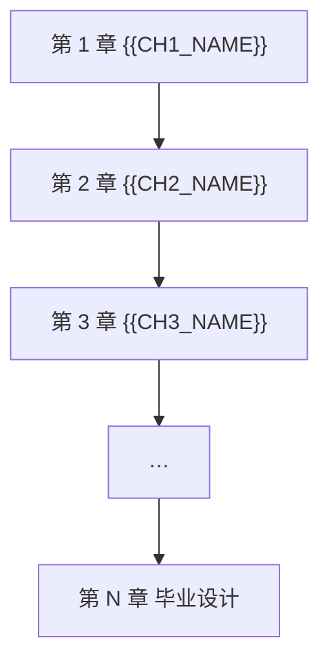

# {{SUBJECT}} 学习笔记 · 总大纲

> <b>*Note*</b>
> 这是什么
>
> 这是 <b>{{SUBJECT}}</b> 的全库总起页。它说明这门科目学什么、怎么学、按什么顺序学，并链接到每一章的每一节。
>
> <b>适合谁</b>：{{TARGET_LEARNER}}
> <b>学完能做到</b>：{{LEARNING_OUTCOMES}}
> <b>前置要求</b>：{{PREREQUISITES}}

<!-- 本文件在笔记根目录，链接章内文件要带章目录：Cha_1%20章名/C1%20Sec_1%20节名.md（百分号编码）。
     本文件里的 HTML 说明注释写完后删掉。 -->

---

## 一、科目简介

{{SUBJECT_INTRO}}

<!-- 3–6 段：这门科目研究什么问题、为什么重要、核心思维方式、常见误区。用通俗语言，不要写成百科条目。 -->

> <b>*Tip*</b>
> 怎么用这套笔记
>
> 1. <b>编辑器</b>：用 Typora 打开（VS Code 等也能读，全文是标准 Markdown）。按本页顺序读，每读完一节把 frontmatter 的 `status` 改成 `学习中` / `已完成`。
> 2. <b>网页端</b>：双击根目录的 `启动学习服务器.bat`（macOS/Linux 用 `./start_server.sh`），浏览器会打开学习门户。在那里做节内练习、看本章速查、考章末测试，进度自动保存。
> 3. 两边读的是同一批文件：在编辑器里改，网页刷新就同步。

---

## 二、学习路线

<b>难度曲线</b>：第 1–{{EASY_END}} 章 入门 · 第 {{MID_START}}–{{MID_END}} 章 进阶 · 第 {{HARD_START}} 章起 挑战

<b>学习顺序建议</b>：{{STUDY_ORDER_ADVICE}}

---

## 三、章节目录

<!-- 每章复制下面这一段。所有链接在内容生成后回填。章标题里不要放 ▸ 等装饰符号，锚点更稳。 -->

### 第 {{CHAPTER_NO}} 章 {{CHAPTER_NAME}}

> <b>一句话导读</b>：{{CHAPTER_BRIEF}}
> <b>难度</b>：{{CHAPTER_DIFFICULTY}} ｜ <b>预计用时</b>：{{CHAPTER_HOURS}}

| 节 | 标题 | 学完你能 | 概念小节 |
|---|---|---|---|
| {{CHAPTER_NO}}.1 | [C{{CHAPTER_NO}} Sec_1 {{SEC1_NAME}}]({{CHAPTER_DIR_URLENC}}/C{{CHAPTER_NO}}%20Sec_1%20{{SEC1_NAME_URLENC}}.md) | {{SEC1_OBJECTIVES}} | [{{SEC1_CONCEPT1}}]({{CHAPTER_DIR_URLENC}}/C{{CHAPTER_NO}}%20Sec_1%20{{SEC1_NAME_URLENC}}.md#{{SEC1_CONCEPT1_ANCHOR}}) |
| {{CHAPTER_NO}}.2 | [C{{CHAPTER_NO}} Sec_2 {{SEC2_NAME}}]({{CHAPTER_DIR_URLENC}}/C{{CHAPTER_NO}}%20Sec_2%20{{SEC2_NAME_URLENC}}.md) | {{SEC2_OBJECTIVES}} | [{{SEC2_CONCEPT1}}]({{CHAPTER_DIR_URLENC}}/C{{CHAPTER_NO}}%20Sec_2%20{{SEC2_NAME_URLENC}}.md#{{SEC2_CONCEPT1_ANCHOR}}) |

<b>本章速查</b>：[C{{CHAPTER_NO}} 速查]({{CHAPTER_DIR_URLENC}}/C{{CHAPTER_NO}}%20%E9%80%9F%E6%9F%A5.md) ｜ <b>本章测试</b>：[C{{CHAPTER_NO}} 测试]({{CHAPTER_DIR_URLENC}}/C{{CHAPTER_NO}}%20%E6%B5%8B%E8%AF%95.md)

---

<!-- 重复块结束 -->

## 四、概念总索引

按概念查（而不是按章查）。概念写名字并链到所在小节的锚点，不用编号：

| 概念 | 所在节 |
|---|---|
| [{{CONCEPT_NAME}}]({{CHAPTER_DIR_URLENC}}/C{{CHAPTER_NO}}%20Sec_{{SEC_NO}}%20{{SEC_NAME_URLENC}}.md#{{CONCEPT_ANCHOR}}) | C{{CHAPTER_NO}} Sec_{{SEC_NO}} {{SEC_NAME}} |

---

## 五、记号与术语约定

全库统一使用下列记号。<b>如果你在其他教材里看到不同约定，以本表为准</b>（正文里会注明差异）。

| 记号 / 术语 | 含义 |
|---|---|
| {{SYMBOL}} | {{MEANING}} |
| {{TERM}} | {{DEFINITION}} |

---

## 六、学习建议

> <b>*Tip*</b>
> 编者按
>
> {{EDITOR_ADVICE}}

> <b>*Warning*</b>
> 常见误区
>
> - {{PITFALL_1}}
> - {{PITFALL_2}}
> - {{PITFALL_3}}

---

## 七、进度追踪

| 章 | 节数 | 概念小节数 | 速查 | 测试 | 状态 |
|---|---|---|---|---|---|
| 1 {{CH1_NAME}} | {{N}} | {{M}} | [C1 速查]({{CH1_DIR_URLENC}}/C1%20%E9%80%9F%E6%9F%A5.md) | [C1 测试]({{CH1_DIR_URLENC}}/C1%20%E6%B5%8B%E8%AF%95.md) | ⬜ |
| 2 {{CH2_NAME}} | {{N}} | {{M}} | [C2 速查]({{CH2_DIR_URLENC}}/C2%20%E9%80%9F%E6%9F%A5.md) | [C2 测试]({{CH2_DIR_URLENC}}/C2%20%E6%B5%8B%E8%AF%95.md) | ⬜ |
