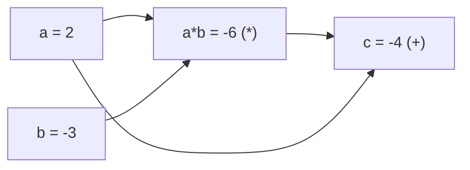

# C1 Sec_2 会自己求导的 Value

> <b>*Note*</b>
> 本节导读
>
> <b>你现在手上</b>：`project/` 里有包 `minigrad/`（只有 `numeric_grad` 一把尺子）、草稿纸 `check.py`、两条通过的测试。能估导数，但每估一个导数都要把函数多算两遍，而且只是近似值。
>
> <b>本节结束时</b>：多出 `minigrad/value.py` 和 `tests/test_value.py` 两个文件。`Value` 在做加法、乘法时自己记账，一次 `backward()` 就算出所有输入的精确导数；一条命令跑完全部测试，用上一节的尺子证明它算得对。
>
> 学完你能：
>
> 1. 写出一个支持 `+`、`*` 并记住来路的 `Value` 类，画出它的计算图；
> 2. 用链式法则手算 `c = a * b + a` 对 `a`、`b` 的导数，并解释 `grad` 为什么要用 `+=`；
> 3. 写出按拓扑序反向传播的 `backward()`，并用数值导数核对它。
>
> <b>前置</b>：[C1 Sec_1 工作台与数值导数](C1%20Sec_1%20%E5%B7%A5%E4%BD%9C%E5%8F%B0%E4%B8%8E%E6%95%B0%E5%80%BC%E5%AF%BC%E6%95%B0.md)；会用链式法则求复合函数的导数。
> <b>预计用时</b>：60 分钟 ｜ <b>难度</b>：入门

## 接上一节

<b>上一节做到</b>：`minigrad.numeric_grad(f, x)` 用中心差分估导数，`python -m unittest discover -s tests -v` 能跑完全部测试。

<b>留下的坑</b>：尺子太贵。估一个导数要算两遍 $f$，一百万个参数就是两百万遍；而且结果只是近似，`6.000000000039306` 不是 6。

<b>本节补上</b>：换个思路。让每个数在参与运算时记下"我是谁和谁、用什么运算算出来的"，算完以后顺着这份账本倒着走一遍，用链式法则一次得到全部导数。最后拿上一节的尺子来量它。

## 第 1 步：造一个包着数字的 Value

【新建】`project/minigrad/value.py`

```python
class Value:
    """包着一个浮点数的标量。后面会让它记住自己是怎么算出来的。"""

    def __init__(self, data):
        self.data = float(data)
        self.grad = 0.0

    def __repr__(self):
        return f"Value(data={self.data}, grad={self.grad})"

    def __add__(self, other):
        return Value(self.data + other.data)

    def __mul__(self, other):
        return Value(self.data * other.data)
```

【修改】`project/minigrad/__init__.py`：导出 `Value`。

```diff
 from .numeric import numeric_grad
+from .value import Value
```

【修改】`project/check.py`：在最后加几行试一试。

```diff
 print("d(x*x)/dx at x=3:", minigrad.numeric_grad(lambda x: x * x, 3.0))
+
+a = minigrad.Value(2.0)
+b = minigrad.Value(-3.0)
+print(a * b + a)
+print(a + 1)
```

【运行】在 `project/` 里：

```bash
python check.py
```

<!-- output: code/out/c1s2-1.txt -->
```text
minigrad 0.1.0
d(x*x)/dx at x=3: 6.000000000039306
Value(data=-4.0, grad=0.0)
Traceback (most recent call last):
  File "check.py", line 9, in <module>
    print(a + 1)
          ~~^~~
  File "minigrad/value.py", line 12, in __add__
    return Value(self.data + other.data)
                             ^^^^^^^^^^
AttributeError: 'int' object has no attribute 'data'
```

现在是坏的：`a * b + a` 正常，`a + 1` 却崩了。`__add__` 里的 `other` 是整数 `1`，整数没有 `.data`。

【重构】`project/minigrad/value.py` 的 `__add__`：遇到普通数字先包成 `Value`。

```python
    def __add__(self, other):
        other = other if isinstance(other, Value) else Value(other)
        return Value(self.data + other.data)
```

【重构】`project/minigrad/value.py` 的 `__mul__`：同样处理。

```python
    def __mul__(self, other):
        other = other if isinstance(other, Value) else Value(other)
        return Value(self.data * other.data)
```

【运行】在 `project/` 里：

```bash
python check.py
```

<!-- output: code/out/c1s2-2.txt -->
```text
minigrad 0.1.0
d(x*x)/dx at x=3: 6.000000000039306
Value(data=-4.0, grad=0.0)
Value(data=3.0, grad=0.0)
```

<b>为什么这样做</b>：Python 看到 `a + 1` 会调用 `a.__add__(1)`，看到 `a * b` 会调用 `a.__mul__(b)`。重载这两个方法，`Value` 就能像普通数字一样写进算式。把普通数字就地包成 `Value`，是为了让后面所有代码只需要处理一种类型。注意 `1 + a` 仍然会报错：Python 先调用整数的 `__add__`，整数不认识 `Value`。第 2 章用 `__radd__` 补上。

## 第 2 步：让每个结果记住来路

现在 `a * b + a` 算出了 `-4.0`，但结果只是一个数，已经忘了自己是从 `a`、`b` 算来的。要倒推导数，就得把这份来路记下来。

### 概念 1：计算图

<b>一句话</b>：把一次计算画成一张图：每个中间值是一个节点，箭头从输入指向由它算出的值。

> <b>*Note*</b>
> 计算图的定义
>
> 计算图是一张有向无环图。节点是计算中出现的每个值；若值 $z$ 由 $x$、$y$ 经某个运算得到，就画边 $x \to z$、$y \to z$，并在 $z$ 上记下运算名。在 minigrad 里，节点就是 `Value`，`_prev` 记它的输入，`_op` 记算出它的运算。

<b>例子</b>：`c = a * b + a` 的计算图：



> <b>*Warning*</b>
> 易错点
>
> `a` 被用了两次，图里仍然只有<b>一个</b> `a` 节点，只是它有两条出边。把它当成两个不同的节点，后面求导时就会漏掉一半贡献。

【重构】`project/minigrad/value.py` 的 `__init__`：多存三样东西。

```python
    def __init__(self, data, _children=(), _op=""):
        self.data = float(data)
        self.grad = 0.0
        self._prev = set(_children)
        self._op = _op
        self._backward = lambda: None
```

【重构】`project/minigrad/value.py` 的 `__add__`：记下来路，并留下"怎么把梯度传回去"。

```python
    def __add__(self, other):
        other = other if isinstance(other, Value) else Value(other)
        out = Value(self.data + other.data, (self, other), "+")

        def _backward():
            self.grad += out.grad
            other.grad += out.grad

        out._backward = _backward
        return out
```

【重构】`project/minigrad/value.py` 的 `__mul__`：

```python
    def __mul__(self, other):
        other = other if isinstance(other, Value) else Value(other)
        out = Value(self.data * other.data, (self, other), "*")

        def _backward():
            self.grad += other.data * out.grad
            other.grad += self.data * out.grad

        out._backward = _backward
        return out
```

【修改】`project/check.py`：看一眼 `c` 记住了什么。

```diff
 print(a + 1)
+
+c = a * b + a
+print("c =", c.data, "op:", c._op, "inputs:", sorted(p.data for p in c._prev))
```

【运行】在 `project/` 里：

```bash
python check.py
```

<!-- output: code/out/c1s2-3.txt -->
```text
minigrad 0.1.0
d(x*x)/dx at x=3: 6.000000000039306
Value(data=-4.0, grad=0.0)
Value(data=3.0, grad=0.0)
c = -4.0 op: + inputs: [-6.0, 2.0]
```

<b>为什么这样做</b>：`_prev` 和 `_op` 就是计算图的边和节点标签。`_backward` 是一个闭包：它记住了这一次加法（或乘法）的 `self`、`other`、`out`，被调用时把 `out.grad` 按局部导数分给两个输入。加法的局部导数是 1，所以原样传回；乘法 $z=xy$ 对 $x$ 的局部导数是 $y$，所以传回 `other.data * out.grad`。现在只是把账记下，还没有人去调用 `_backward`。

## 第 3 步：从结果往回走：backward

### 概念 2：反向传播

<b>一句话</b>：从输出出发，沿计算图反方向，用链式法则把"输出对我的导数"一层层传回每个输入。

> <b>*Note*</b>
> 反向传播的定义
>
> 记输出为 $L$，节点 $v$ 的 `grad` 存 $\frac{\partial L}{\partial v}$。从 $\frac{\partial L}{\partial L}=1$ 开始，按拓扑序的逆序访问节点：若 $z = g(x, y)$，则
>
> $$
> \frac{\partial L}{\partial x} \mathrel{+}= \frac{\partial g}{\partial x} \cdot \frac{\partial L}{\partial z}
> $$
>
> 一个节点有多条出边时，各条路径的贡献相加（多元链式法则）。

<b>例子</b>：`c = a * b + a`，`a = 2`，`b = -3`。路径一经过乘法：$\frac{\partial c}{\partial a} \mathrel{+}= b \cdot 1 = -3$；路径二直接相加：$\frac{\partial c}{\partial a} \mathrel{+}= 1$。合计 $-2$。对 `b` 只有一条路径：$a \cdot 1 = 2$。

> <b>*Warning*</b>
> 易错点
>
> 必须等一个节点的所有下游都传完，才能调用它的 `_backward`，否则它手里的 `out.grad` 还不完整。拓扑序保证了这一点：先把图按"输入在前、输出在后"排好，再倒着走。

【修改】`project/minigrad/value.py`：在 `__repr__` 后面加 `backward` 方法。

```diff
     def __repr__(self):
         return f"Value(data={self.data}, grad={self.grad})"
+
+    def backward(self):
+        """从自己出发，按拓扑序的逆序把梯度传回每个输入。"""
+        order, seen = [], set()
+
+        def visit(v):
+            if v not in seen:
+                seen.add(v)
+                for child in v._prev:
+                    visit(child)
+                order.append(v)
+
+        visit(self)
+        self.grad = 1.0
+        for v in reversed(order):
+            v._backward()
```

【修改】`project/check.py`：反向传播一次，再来一次。

```diff
 print("c =", c.data, "op:", c._op, "inputs:", sorted(p.data for p in c._prev))
+
+c.backward()
+print("a.grad =", a.grad, "b.grad =", b.grad)
+c.backward()
+print("again: a.grad =", a.grad, "b.grad =", b.grad)
```

> <b>*Tip*</b>
> 先猜一猜
>
> 第一次 `backward()` 之后 `a.grad` 应该是手算的 $-2$。紧接着再调一次，`a.grad` 会是多少？先写下你的答案。

【运行】在 `project/` 里：

```bash
python check.py
```

<!-- output: code/out/c1s2-4.txt -->
```text
minigrad 0.1.0
d(x*x)/dx at x=3: 6.000000000039306
Value(data=-4.0, grad=0.0)
Value(data=3.0, grad=0.0)
c = -4.0 op: + inputs: [-6.0, 2.0]
a.grad = -2.0 b.grad = 2.0
again: a.grad = -7.0 b.grad = 6.0
```

<b>为什么第二次全错了</b>：第一行和手算一致。第二行不是 $-4$ 和 $4$（简单翻倍），而是 $-7$ 和 $6$，比翻倍还糟。原因是 `_backward` 里写的是 `+=`，而第二次反向传播开始时只有 `c.grad` 被重新设成 1，中间节点 `a*b` 的 `grad` 还留着上一次的 1，这次加成了 2：于是 `a` 经乘法收到 $-3 \times 2 = -6$，再加上直接相加那条路的 $1$ 和上一次留下的 $-2$，得到 $-7$；`b` 收到 $2 \times 2 = 4$，加上上一次的 $2$ 得到 $6$。`+=` 本身没错（`a` 有两条路径，必须相加），错在两次之间没有把<b>所有</b>节点清零。这个坑留到第 2 章用 `zero_grad` 解决；在那之前，每次 `backward()` 前都重新建一遍 `Value`。

## 第 4 步：章末通跑：用尺子量 backward

最后一步把本章两节连起来：用 Sec_1 的 `numeric_grad` 检验 Sec_2 的 `backward`。

【新建】`project/tests/test_value.py`

```python
import unittest

from minigrad import Value, numeric_grad


def f(x, y):
    return x * y + x * x + 3


class TestBackward(unittest.TestCase):
    def test_matches_numeric_grad(self):
        x, y = Value(1.5), Value(-2.0)
        out = f(x, y)
        out.backward()
        self.assertAlmostEqual(x.grad, numeric_grad(lambda t: f(t, -2.0), 1.5), places=6)
        self.assertAlmostEqual(y.grad, numeric_grad(lambda t: f(1.5, t), -2.0), places=6)


if __name__ == "__main__":
    unittest.main()
```

【运行】在 `project/` 里，一条命令跑完整个项目的测试：

```bash
python -m unittest discover -s tests -v
```

<!-- output: code/out/c1s2-5.txt -->
```text
test_cube (test_numeric.TestNumericGrad.test_cube) ... ok
test_square (test_numeric.TestNumericGrad.test_square) ... ok
test_matches_numeric_grad (test_value.TestBackward.test_matches_numeric_grad) ... ok

----------------------------------------------------------------------
Ran 3 tests in 0.000s

OK
```

<b>为什么这样核对</b>：同一个 `f` 既能吃 `Value`（走 `backward`），也能吃普通浮点数（走 `numeric_grad`），两条完全独立的路算出同一个导数，才能互相作证。手算一遍：$\frac{\partial f}{\partial x} = y + 2x = 1$，$\frac{\partial f}{\partial y} = x = 1.5$。

【收口】`project/minigrad/value.py` 做完本章应该和下面一字不差。对不上就回头找漏掉的那一步。

```python
class Value:
    """包着一个浮点数的标量。后面会让它记住自己是怎么算出来的。"""

    def __init__(self, data, _children=(), _op=""):
        self.data = float(data)
        self.grad = 0.0
        self._prev = set(_children)
        self._op = _op
        self._backward = lambda: None

    def __repr__(self):
        return f"Value(data={self.data}, grad={self.grad})"

    def backward(self):
        """从自己出发，按拓扑序的逆序把梯度传回每个输入。"""
        order, seen = [], set()

        def visit(v):
            if v not in seen:
                seen.add(v)
                for child in v._prev:
                    visit(child)
                order.append(v)

        visit(self)
        self.grad = 1.0
        for v in reversed(order):
            v._backward()

    def __add__(self, other):
        other = other if isinstance(other, Value) else Value(other)
        out = Value(self.data + other.data, (self, other), "+")

        def _backward():
            self.grad += out.grad
            other.grad += out.grad

        out._backward = _backward
        return out

    def __mul__(self, other):
        other = other if isinstance(other, Value) else Value(other)
        out = Value(self.data * other.data, (self, other), "*")

        def _backward():
            self.grad += other.data * out.grad
            other.grad += self.data * out.grad

        out._backward = _backward
        return out
```

本章所有文件的标准答案在 `code/answer/ch01/`，结构和你的 `project/` 一模一样。全部测试通过以后再去对照；没通过时，先用上面的【收口】定位是哪一步漏了。

## 本节小结

> <b>*Tip*</b>
> 记住这些
>
> 1. 重载 `__add__` / `__mul__`，`Value` 就能写进普通算式；普通数字先包成 `Value`。
> 2. 每个 `Value` 用 `_prev`、`_op` 记住来路，整场计算就是一张计算图。
> 3. `_backward` 闭包按局部导数分梯度：加法原样传回，乘法乘上另一个输入。
> 4. `backward()` 先拓扑排序，再从输出（`grad = 1`）倒着调用每个 `_backward`。
> 5. `grad` 用 `+=` 是因为多条路径要相加；两次 `backward()` 之间不把所有节点清零，梯度就会越积越错。
> 6. 自动求导写完，用数值导数核对；`python -m unittest discover -s tests -v` 是全项目体检。

### 本章项目地图

做完第 1 章，你的 `project/` 应该是这样：

```text
project/
├── check.py              草稿纸：每加一个功能加几行打印（Sec_1 新建，Sec_2 修改）
├── minigrad/
│   ├── __init__.py       包入口，导出 numeric_grad 与 Value（Sec_1 新建，Sec_2 修改）
│   ├── numeric.py        numeric_grad：用中心差分估导数，全课的尺子（Sec_1 新建）
│   └── value.py          Value：会记账、会 backward 的标量（Sec_2 新建）
└── tests/
    ├── test_numeric.py   尺子自己的测试（Sec_1 新建）
    └── test_value.py     用尺子量 backward（Sec_2 新建）
```

<b>本章动了</b>：上面 6 个文件全部是本章新建的。第 2 章会修改 `value.py`（加 `zero_grad` 和更多运算）和 `tests/`，其余文件不动。

<b>留给下一节</b>：连调两次 `backward()` 梯度就错了，`1 + a` 还会报错，`Value` 也只会加和乘。第 2 章从 `zero_grad` 开始，把它补成能训练一个小模型的样子。

## 本节练习

**1.** 对 `c = a * b + a`（`a = 2`，`b = -3`）调用一次 `c.backward()` 后，`a.grad` 是多少？

A. -3　B. 1　C. -2　D. 2

> <b>*Note*</b>
> 答案与解析
>
> <b>答案</b>：C
>
> <b>解析</b>：`a` 有两条路径通向 `c`：经过乘法贡献 $b = -3$，直接相加贡献 $1$，合计 $-2$。选 A 的同学漏了相加那条路径，选 B 的同学漏了乘法那条。

**2.** 判断：连续调用两次 `c.backward()` 后，`a.grad` 恰好是第一次的两倍，即 -4.0。

> <b>*Note*</b>
> 答案与解析
>
> <b>答案</b>：错误
>
> <b>解析</b>：第 3 步的真实输出是 -7.0。第二次反向传播只把 `c.grad` 重设为 1，中间节点 `a*b` 的 `grad` 从 1 累加成 2，传给 `a` 的就成了 $-3\times2=-6$，再加直接路径的 1 和上一次的 -2，得到 -7。认为"只是翻倍"的同学忘了中间节点也在累加。要得到正确结果，两次之间得把所有节点的 `grad` 清零。

**3.** `_backward` 里写 `self.grad += …` 而不是 `self.grad = …`，是因为同一个 `Value` 可能有多条通往输出的路径，每条路径的梯度要 ______ 起来。

> <b>*Note*</b>
> 答案与解析
>
> <b>答案</b>：相加
>
> <b>解析</b>：这是多元链式法则：$\frac{\partial L}{\partial x} = \sum_{\text{每条出边}} \frac{\partial z_i}{\partial x}\frac{\partial L}{\partial z_i}$。如果写成 `=`，后传回来的路径会覆盖先传回来的，`a.grad` 就会变成 -3 或 1。

**4.** 对 $f(x, y) = xy + x^2 + 3$，在 $x = 1.5$、$y = -2$ 处手算 $\frac{\partial f}{\partial x}$ 与 $\frac{\partial f}{\partial y}$，并说明 `test_value.py` 为什么要同时用 `backward` 和 `numeric_grad` 算它们。

> <b>*Note*</b>
> 答案与解析
>
> <b>答案</b>：$\frac{\partial f}{\partial x} = y + 2x = 1$，$\frac{\partial f}{\partial y} = x = 1.5$。
>
> <b>解析</b>：`backward` 和 `numeric_grad` 是两条互不依赖的路：一条靠链式法则精确求导，一条靠差商近似。两者在 6 位小数内一致，才说明 `backward` 写对了；只用其中一条，错了也看不出来。

## 概念索引

1. [计算图](#概念-1-计算图)
2. [反向传播](#概念-2-反向传播)

---

上一节：[C1 Sec_1 工作台与数值导数](C1%20Sec_1%20%E5%B7%A5%E4%BD%9C%E5%8F%B0%E4%B8%8E%E6%95%B0%E5%80%BC%E5%AF%BC%E6%95%B0.md) · 返回大纲：[00 大纲](../00%20%E5%A4%A7%E7%BA%B2.md) · 本章速查：[C1 速查](C1%20%E9%80%9F%E6%9F%A5.md) · 本章测试：[C1 测试](C1%20%E6%B5%8B%E8%AF%95.md)
